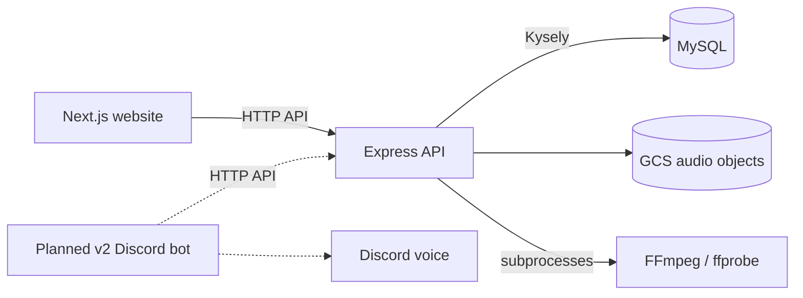

# KevBot architecture

Implementation snapshot: `main` at `789bfc4` (2026-10-16), after publication of
the accepted parity contract. This is a source map, not a claim about what is
deployed. [PRD.md](PRD.md) owns product outcomes;
[ROADMAP.md](ROADMAP.md) owns scope/order, and the
[documentation index](docs/README.md) links contracts and operational instructions.

## Components and boundaries

| Component | Current responsibility and limits |
| --- | --- |
| [API](api/src/app.ts) | Express/TypeScript REST service; authentication, validation, library/personal preferences, audio processing, activity writes and unified search. Kysely accesses MySQL; GCS stores media. |
| [Frontend](frontend/src/app) | Next.js 15 App Router; Discord login, browse/search, profiles, playlist pages and single-track playback. Upload/management controls, playlist queue/play reporting and complete statistics remain work. |
| [Database](db/migration) | MySQL 8; forward semver SQL baseline/migrations, users, library data, preferences and play counts. The API's expected schema version is configured independently of component release tags. |
| [Storage emulator](gcloud/docker-compose.yml) | Local fake GCS on port 4443, backed by `gcloud/data`. It emulates object storage; checked-in fixtures do not establish production data correctness. |
| [Tools](tools/Dockerfile) | Python migration manager, rename utility and helpers. Maintenance tools can use database/storage credentials; ordinary client operations must use the API. |
| Replacement Discord bot | Planned `bot/` service; no such service is present in this baseline. Accepted design is linked below. |
| [Legacy bot](v1/README.md) | Historical implementation and compatibility evidence. It accesses legacy data/storage directly and is not interchangeable with the v2 schema or a completed replacement bot. |

Dashed connections describe planned integration. The existing web player uses
the track stream endpoint through an HTML audio element; it does not yet provide
the complete playlist/play-reporting behavior required by the product scope.
See [player source](frontend/src/lib/contexts/music-player-context.tsx).

## Identity, authorization and contracts

Current [auth routes](api/src/routes/authRoutes.ts) implement Discord exchange,
refresh, logout and current-user lookup. The API also issues bot service tokens
through [bot auth](api/src/routes/botRoutes.ts). The baseline verifier maps a bot
token to user ID `0`; that is not a real acting-user model. See
[token verification](api/src/services/authService.ts).

The owner accepted D1–D11, the permission matrix and playback/reporting semantics
in [#141](https://github.com/k1dkev/KevBot/issues/141#issuecomment-6207636658),
with publication recorded by [#169](https://github.com/k1dkev/KevBot/pull/169).
The [parity inventory](specs/bot-parity.md) and
[decision contract](specs/bot-parity-decisions.md) specify the planned boundary:
trusted bot authentication plus validated Discord actors, shared library policy
and no bot database/GCS credentials. They do not establish runtime completion.
[#157](https://github.com/k1dkev/KevBot/issues/157) owns the API actor/policy work
and matching public API docs; #158–#163 cover the remaining adapters/acceptance.

Some read/search/play routes currently permit anonymous access. Reconciling
that behavior with security prose, deleted-content visibility and intended
public access remains #145. Route/schema code is the observed baseline; this
architecture does not choose a new security policy or duplicate endpoint tables.

## Audio and persistence flow

The [upload controller](api/src/controllers/tracksController.ts) validates the
multipart upload, extension/format and duration. It invokes ffprobe and the
two-pass FFmpeg helpers in [audioUtils](api/src/utils/audioUtils.ts), then checks
normalized duration and loudness. These are subprocesses run during the API
request, not a separately deployed normalization worker.

The [track service](api/src/services/tracksService.ts) opens a SQL transaction,
inserts the track to obtain its ID, uploads normalized audio as `{id}.mp3` and
the original as `{id}.original.mp3`, then completes the transaction. GCS writes
are not part of a distributed SQL transaction: a partial storage failure can
need compensation. The controller attempts temporary-file cleanup in `finally`.
Do not interpret that sequence as guaranteed atomic database/object cleanup.

Streaming reads the ID-addressed normalized object and supports HTTP ranges.
Activity reporting uses separate API writes; streaming alone is not evidence
that the frontend or planned bot reports a successful play. Accepted bot start
reporting, idempotency, pools and overlap behavior remain implementation work.

Current numeric/file/name limits live in [API config](api/src/config/config.ts),
schemas and controllers. The [PRD](PRD.md#current-foundation-and-remaining-work)
distinguishes the baseline from accepted #157 boundary changes; avoid copying
another competing table of limits here. Audio normalization changes in other
unmerged branches are not included in this snapshot.

## Development and startup

The root [Compose file](docker-compose.dev.yml) includes MySQL, fake GCS, API and
tools. It starts neither the frontend nor a bot. It also does not automatically
apply database migrations. The tools container sleeps until invoked; its source
mount is `/KevBot`, while the image includes tools at `/tools` and isolated
Python interpreters under `/opt`.

Use the [root setup commands](README.md#local-development),
[API build/test runbook](api/README.md),
[migration-manager runbook](tools/db/migration_manager/README.md) and
[frontend checks](frontend/README.md#checks-and-browser-smoke-tests).
Python dependency setup follows the checked-out migration-manager runbook;
uv adoption in #153 is separate from this baseline.

The API reads and validates runtime configuration in
[configFactory](api/src/config/config.ts). The frontend separately validates
public browser configuration in [getConfig](frontend/src/lib/config.ts).
Local env files are ignored and must match the selected topology; matching
variable names does not mean host and container addresses should be identical.
Environment-example and full security-contract reconciliation remain follow-up
work under #145. No secrets or production state are documented here.

## Build, verification and delivery

The [API Dockerfile](api/Dockerfile) compiles TypeScript and packages OpenAPI YAML
for the production target, alongside runtime dependencies and FFmpeg. The
[CI workflow](.github/workflows/continuos-integration.yml) configures migration
checks, frontend lint/unit/build/browser checks, API Testcontainers integration
tests and a production-image smoke check. Test configuration is not evidence
of a completed live Discord/OAuth/storage/production cutover.

Frontend browser checks use synthetic API/audio fixtures. API integration checks
use disposable MySQL and the standalone migration-manager image. Migration tests
cover nonzero failures and verified TLS. There is no v2 bot CI target yet.

[Release automation](CONTRIBUTING.md#releases) updates component versions and
changelogs and can create tags/GitHub Releases. Deployment and hosted migration
workflows are separately dispatched; publishing a release is not deployment
evidence. Actual hosting topology and backup/restore/cutover readiness require
the operational work in [M3](ROADMAP.md#m3--production-cutover-and-operation).
