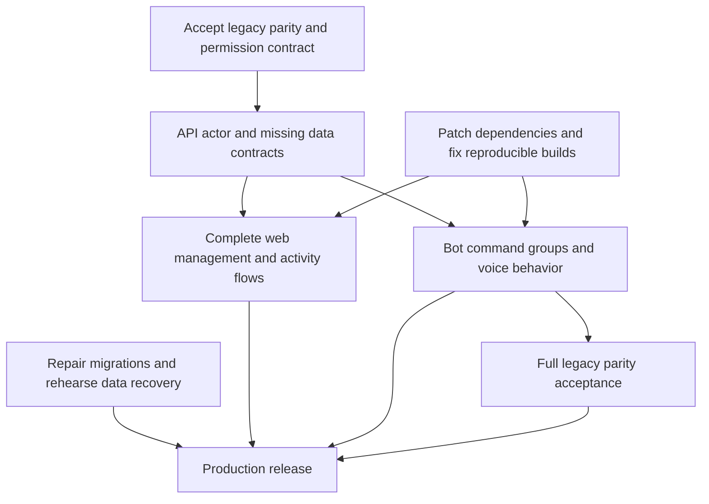

# KevBot v2 roadmap

Drafted on 2026-10-08 from the working branch, GitHub issues, repository docs,
and the KevBot Obsidian notes. Reviewed implementation: `07180b4` on
`feat/frontend-overhaul`, 18 commits ahead of `main` at the time of review.

This is the consolidated plan. GitHub issues will track execution once the
backlog is triaged. The [planning audit](docs/PLANNING_AUDIT.md) records evidence
and historical sources; it is not another active backlog.

## Release goal

Ship one shared audio platform with four core areas:

- **API:** Own identity, authorization, audio processing, library data, and activity.
- **MySQL and migrations:** Preserve existing data and provide a dependable upgrade,
  backup, and recovery process for the hosted database.
- **Frontend:** Let users browse, play, upload, and manage the shared library.
- **Discord bot:** Replace the legacy bot with an API client that supports its full
  command set and voice-event behavior.

The first usable v2 release must match the legacy bot's full command set. Basic
playback is an internal checkpoint, not the release boundary. Every legacy
command, alias, argument mode, permission rule, and greeting/farewell behavior
must be accounted for in the [accepted parity specification](specs/bot-parity.md).
The current specification is a draft inventory. Fixes to legacy bugs
or deliberate behavior changes must be documented rather than silently inherited.

Keep MySQL, Kysely, GCS, the existing migration manager, and the current API
structure as the starting point. Replacing the database, ORM, migration tool,
or architecture is not a prerequisite for finishing v2.

## Where we are

| Area | Existing foundation | Main remaining work |
| --- | --- | --- |
| API | Discord login, access/refresh sessions, bot authentication, track upload/normalization/streaming, playlists, preferences, play logging, unified search | Bot acting-user authorization, missing legacy activity queries, contract cleanup, correctness fixes, production packaging |
| MySQL and migrations | Legacy baseline, forward migrations through `2.14.0`, migration history, Docker/Python manager, backup utilities | Repair hosted migration workflow, validate existing data, rehearse upgrades/restores, make failure handling reliable |
| Frontend | Discord login, search/browse, track playback, user/playlist pages, shared tables | Upload and editing flows, playlist queue behavior, automatic activity reporting, real statistics, placeholder cleanup |
| Bot | Legacy implementation and command behavior under `v1/` | New `bot/` service, API integration, voice lifecycle, full command parity, deployment |
| Delivery | API Testcontainers CI, release-please, manual infrastructure workflows | Reproducible production images, frontend/bot checks, deployment runbooks and verified release gates |

Existing code is not proof of a deployed or tested feature. This audit did not
access production. The API build and 35 search integration tests passed earlier
in this session; the whole test suite, frontend, and production images have not
been validated during this planning pass.

## Milestones and completion gates

Milestones describe outcomes, not dates. Use these names for GitHub milestones
so release membership is stored in one place.

### M0 — Reliable development and release foundation

Outcome: the current project is understandable, reproducible, and ready for
bounded implementation work.

1. Review and accept the [legacy bot parity draft](specs/bot-parity.md), using
   the actual command registry and event handlers as well as its README.
2. Update the frontend's Next.js/React dependencies against current advisories.
   The current branch pins Next.js `15.1.7`; the old security PR targets a
   different branch and is not sufficient evidence that this branch is patched.
3. Review and land the current frontend branch through a scoped PR. Preserve the
   work already completed rather than starting another frontend rewrite.
4. Repair the API production build: compile tracked TypeScript, package the
   OpenAPI YAML, and verify the image contains FFmpeg and starts correctly.
5. Repair the database migration workflow to use the current migration CLI and
   connection configuration. Migration failures must produce a failing exit code.
6. Establish a documented local setup with synthetic fixtures, current environment
   examples, and applicable CI checks for the API, frontend, and migration tool.
7. Refresh the canonical product, architecture, auth, search, setup, and release
   docs; retire old planning checklists once their remaining items are accounted for.

Gate: a fresh checkout can start the documented development setup; applicable
checks run; the clean API production image works; disposable migration runs
prove success and failure behavior; accepted parity and permission decisions
exist; the frontend has a reviewed dependency baseline.

### M1 — Complete the shared library workflows

Outcome: the web client provides a complete shared-library experience, and the
API contracts needed by both clients are settled.

- Fix browser OAuth state validation and session coordination, including concurrent
  refresh, callback/exchange races, and logout when the access token has expired.
- Make search URLs/back-forward behavior reproduce the visible query and filters;
  prevent stale pagination requests from appending results from an old query.
- Finish web upload, track rename/delete/restore/download, playlist creation and
  editing, membership changes, and greeting/farewell assignment. Reuse existing
  endpoints; add API capabilities only where an accepted workflow requires them.
- Specify and implement basic web playlist playback, empty/deleted-track behavior,
  and search within a playlist. Advanced queue controls, repeat, and shuffle need
  separate scope decisions; remove inert controls until their behavior is implemented.
- Report actual playback through the existing activity endpoints; define when a
  play counts, how failed starts are handled, and how duplicate reports are avoided.
- Replace fake statistics and controls. Expose the user/playlist counts needed by
  accepted screens, or hide unsupported metrics until implemented.
- Correct query validation and contract drift, including textual boolean handling,
  public versus authenticated reads, deleted content visibility, and sort defaults.
- Implement the bot acting-user contract in the API. A bot principal and the
  Discord user it represents are distinct; actions must have correct ownership
  and activity attribution without using user ID `0` as a real actor.
- Reconcile legacy permission rules: shared additions, creator/configured-master removal,
  protected categories, and nonempty deletion. Do not replace these with a blanket
  ownership rule without an explicit decision.

Gate: a user can sign in, upload, find and play a track, create and play a
playlist, edit their content, and set preferences. Ownership errors and session
expiry are handled clearly. Displayed counts are real. API contracts cover the
bot parity requirements, with relevant authorization and workflow checks.

### M2 — Full Discord bot parity

Outcome: the new bot can replace the legacy bot in a test guild.

- Scaffold `bot/` with TypeScript, validated configuration, its own Docker/compose
  setup, root integration, and CI. The bot accesses library data through the API.
- Implement bot authentication, actor resolution/delegation, token renewal,
  request timeouts, and useful Discord responses to API errors.
- Implement the [accepted command parity specification](specs/bot-parity.md) in
  bounded groups: dispatch/help, play/raid, list/random, category management,
  uploads, greeting/farewell commands, and automatic voice events.
- Implement per-guild voice connection/player lifecycle and the required play,
  random, raid, greeting, and farewell behaviors.
- Implement legacy special list/random modes using API queries. Add read APIs for
  activity/history where needed; existing activity routes primarily write logs.
- Verify both command behavior and voice events with Discord stubs, then perform
  a real test-guild acceptance run. Check playback errors, reconnects, channel
  moves, interruption, overlapping events, and shutdown.

Gate: every row in the accepted parity matrix has an implementation reference
and verification evidence. The agreed command syntax and aliases work. Uploads,
playlist changes, preferences, and plays resolve to the correct user. The bot
has no direct database or GCS credentials.

Slash commands are a separate interface decision: the old issue requesting them
does not make them existing legacy functionality. Preserve configured prefix
access for the first release; slash commands are additive unless the user
explicitly approves replacing that access.

### M3 — Production cutover and operation

Outcome: the API, hosted MySQL, frontend, and replacement bot can be operated
as one release without losing the legacy library.

- Confirm the actual DigitalOcean hosting model, deployed schema, API/frontend/bot
  hosts, origins, storage buckets, and existing release versions. The repository
  contains Droplet workflows; managed-database hosting has not been established.
- Run data checks before applying migrations: Discord identity coverage, ownership,
  greeting/farewell mappings, active-name uniqueness, and audio-object consistency.
- Rehearse the upgrade against a disposable copy of the current schema/data.
  Define backup retention and recovery for MySQL and both normalized/original audio.
- Harden migration execution and recovery for concurrent runs, changed applied
  scripts, unknown baselines, and partially applied DDL. Forward-only migrations
  still need a documented restore/reconciliation procedure.
- Deliver and verify deployment for the API, frontend, and bot; validate targets
  and separate destructive resets from routine deployments. Confirm normal database
  redeployment preserves its persistent data.
- Add useful application/command logs and operational failure notifications; decide
  abuse and rate-limit controls for auth, upload, streams, and public play reporting.
- Complete the parity acceptance run, publish accurate release notes, and document
  a controlled handover from the legacy bot without duplicate voice/play events.

Gate: all four core areas pass their acceptance checks; full bot parity is proven;
the production upgrade and restore paths are rehearsed; dependency advisories are
rechecked at release time; deployed versions and operator instructions are recorded.

## Dependency order and parallel work



Start parity design immediately. Production packaging, hosted-migration repairs,
and frontend dependency updates can run independently. Frontend work and bot
work can overlap after the relevant API contracts are accepted. MySQL recovery
work should proceed early rather than being discovered at cutover.

## First issue batch

These are draft issue descriptions, not created GitHub tickets. Create this
small batch first; expand later milestones when dependencies and designs are
ready. One ticket should normally produce one reviewable PR.

| Order | Draft issue | Area | Completion criteria |
| --- | --- | --- | --- |
| 1 | Finalize the full legacy bot parity contract | Bot/API | Review the existing draft inventory; settle command, duration, ranking, and permission decisions; map v2/API gaps; define test-guild acceptance |
| 2 | Patch the current frontend dependency baseline | Frontend | Review current official advisories; update compatible Next/React and related tooling; validate lockfile, build, auth, and core pages; resolve the old security PR appropriately |
| 3 | Make the API production image reproducible | API/platform | Clean tracked-source image compiles, packages OpenAPI docs, contains FFmpeg, starts with valid config, and passes an image check in CI |
| 4 | Repair hosted migration execution | DB/tools | Confirm hosting and secure connection requirements; update workflow to current CLI; verify dry run, explicit version, already-current case, and nonzero failure |
| 5 | Reconcile the current docs and release workflow | Platform | Refresh PRD/architecture/auth/OpenAPI/search/setup docs against accepted behavior; reconcile actual release/settings config; replace obsolete duplicate plans with links |
| 6 | Review and integrate the existing frontend overhaul | Frontend | Produce a scoped PR from the current branch; identify and separate unfinished placeholders; verify changed browsing/profile/player flows before merging |

Next issues should cover trusted bot actors, shared permission rules, missing
history queries, web upload/edit flows, playlist playback, real activity/stats,
and migration recovery. Give each its own acceptance criteria and dependencies;
avoid tickets such as "finish API" or "build frontend."

## How to manage the work

Use **GitHub Issues + one GitHub Project + repo design docs**. Avoid maintaining
the same checklist in Obsidian, `TODOS.md`, a roadmap, and issue bodies.

| Information | Authoritative home | Update rule |
| --- | --- | --- |
| Goals, release gates, phase order | This roadmap | Change when scope or sequencing changes; link milestone/epic issues once created |
| Tasks, priority, assignee, dependencies, progress | GitHub Issues and the Project | Update during implementation and review; close through the implementation PR |
| Product scope and user outcomes | `PRD.md` after reconciliation | Keep concise; link contracts rather than reproducing endpoint tables |
| Architecture and service boundaries | `ARCHITECTURE.md` after reconciliation | Describe implemented structure; clearly label proposed changes |
| Cross-service behavior and feature designs | `specs/` | Review with code; update accepted contracts in the same PR as behavior changes |
| Durable choices and rationale | `DECISIONS.md` | Record accepted decisions and superseded choices, not a task backlog |
| Setup, tests, deployment, recovery | `CONTRIBUTING.md` and component runbooks | Keep commands reproducible; avoid duplicate installation recipes |
| Release history | Generated component changelogs and `RELEASE_NOTES.md` | Keep technical history and user-facing highlights distinct |
| Personal exploration/session notes | Obsidian | Keep scratch notes; promote selected decisions/tasks to repo/GitHub and link back |

### GitHub setup

- One Project named **KevBot v2**; link this repository.
- Status: **Backlog → Ready → In progress → In review → Done**.
- Project Priority: **P0** release blocker, **P1** required for v2, **P2** later.
- Area labels: `area:api`, `area:db`, `area:frontend`, `area:bot`, `area:platform`.
  Use existing `bug`, `enhancement`, and `documentation` labels for work type.
- Add `epic` for parent initiatives and `legacy` for historical tickets awaiting
  triage. Use sub-issues for independently implementable pieces.
- Use the M0–M3 milestones above. Do not duplicate milestone membership in a
  separate Phase field or copy priority into both labels and Project fields.
- Keep views for **Ready**, **Current work**, **By area**, and **Release milestones**.
  Use a timeline only when actual target dates are agreed.
- Enable issue/PR completion automation; use native blocking relationships where
  available. Do not automatically close legacy tickets based on age.
- Limit active implementation to one ticket per agent and avoid overlapping write
  scopes. A few Ready tickets are more useful than dozens of vague open tasks.

GitHub supports parent/sub-issues, dependencies, custom Project fields, and
automated status updates. See its [Project guidance](https://docs.github.com/en/issues/planning-and-tracking-with-projects/learning-about-projects/best-practices-for-projects)
and [issue dependency docs](https://docs.github.com/en/issues/tracking-your-work-with-issues/using-issues/creating-issue-dependencies).

The current CLI token lacks `read:project`, so existing Projects could not be
inventoried. Project creation/configuration would require the corresponding
access. Issues, labels, milestones, and PRs were readable. Nothing was created
or changed on GitHub during this audit.

### What makes an issue Ready

An issue needs a concrete problem, expected behavior, affected components,
acceptance checks, dependencies, and links to any required design. Resolve
product or permission decisions before handing it to an implementation agent.

Suggested issue body:

```markdown
## Problem and expected behavior

Describe the user-visible result and the current gap.

## Scope

Name affected components, contracts, and explicit boundaries.

## Acceptance criteria

- [ ] Observable outcome
- [ ] Relevant failure/permission behavior
- [ ] Applicable verification and docs updates

## Dependencies and design

Link blocking issues, the accepted spec, and relevant decisions.
```

### Design docs and decisions

Write a design doc for behavior spanning clients, identity/permissions, schema
changes, or major playback semantics. Small corrections can stay in an issue.
Prefer extending an existing relevant spec over creating a competing design.

A spec should contain: **status** (Draft/Accepted/Implemented/Superseded),
problem/goals, current behavior, chosen behavior, API/data contracts, permission
and failure cases, verification, rollout/data impacts, open questions, and
linked issues. Mark speculative alternatives explicitly. Record the chosen
tradeoff in `DECISIONS.md` once accepted.

The [full bot parity draft](specs/bot-parity.md) is the first concrete design.
Next designs cover trusted bot actors/permissions and playback reporting/queue
semantics as their tickets are worked. Existing search and auth docs need
reconciliation first.

### Working with implementation agents

1. Give an agent one Ready issue and its accepted spec; ask it to inspect relevant
   current code and repository instructions before editing.
2. Request an implementation that satisfies acceptance criteria, meaningful
   verification, and matching contract/docs changes.
3. Delegate independent work with disjoint files. Establish shared API contracts
   before parallel frontend/bot implementations consume them.
4. Review the diff and evidence, including migrations and environment changes.
   Link the PR using `Closes #...` once the issue is actually satisfied.
5. End a session by updating the issue/Project with the current result, remaining
   blocker, and next action. Update this roadmap only if the release plan changes.

## Deferred ideas

Preserve these as ideas until deliberately prioritized: audio effects, Opus
storage changes, zip/bulk uploads, normalization preview, advanced analytics,
artwork, richer mobile UX, advanced queue/shuffle/repeat controls, silence-aware
greetings, birthdays, desktop hotkeys,
additional user privilege tiers, database/provider replacement, migration-tool
replacement, and broad factory-pattern refactoring.

Slash commands are desirable but require an interface decision. Full legacy
parity does not automatically include every unimplemented legacy enhancement.

## Decisions still needed

- Actual hosting/deployment layout and current production versions/data state.
- Public versus authenticated library reads, anonymous plays, and deleted-content
  visibility. Current routes and older docs disagree.
- Formal replacement for the legacy master-user/protected-category rules.
- Whether slash commands ship alongside the existing prefixes or replace them.
- Minimal web playlist playback and bot behavior when commands/voice events overlap;
  advanced queue/shuffle/repeat controls need a separate scope decision.
- Backup retention, storage cleanup, and recovery expectations.

These decisions belong in accepted specs or `DECISIONS.md`; do not resolve them
implicitly inside an agent's implementation PR.
